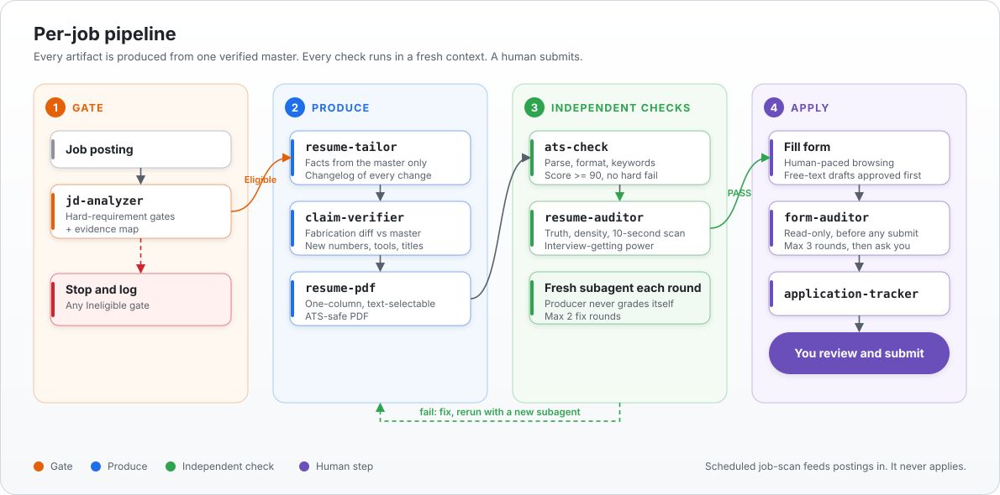

# job-search-skills

**Evidence-based job search, as composable agent skills.**
Gate the posting. Tailor from verified facts. Let a fresh agent audit the result. You press submit.

---

## Why

Most AI resume tools optimize for volume and invent claims. This pipeline optimizes for **truth and fit**:

- **One verified master resume** is the only fact source. Tailoring can reorder and trim, never add.
- **The producer never grades its own work.** Every quality gate runs in a brand-new subagent context.
- **Hard requirements are checked first.** A failed gate stops the job before any effort is spent.
- **Nothing is submitted automatically.** The pipeline stops at a human.

## The pipeline

 Click the diagram to open it full size.

A separate scheduled flow, `job-scan`, polls public ATS boards, runs `jd-analyzer` on new postings only, and notifies on strong fits. It never applies.

## Quality gates at a glance

| Gate | Type | Pass condition | Retry cap |
|---|---|---|---|
| Requirements | Rule check | No Ineligible gate | none (stop) |
| Fabrication | Script | No new numbers, tools, titles, dates vs master | fix and rerun |
| ATS readiness | Script, fresh subagent | Score >= 90 and no hard fail | 2 rounds |
| Resume audit | Rubric, fresh subagent | Verdict PASS | 2 rounds |
| Form audit | Rubric, fresh subagent, read-only | Verdict PASS | 3 rounds, then ask human |
| Submit | Human | You click | n/a |

> The ATS score is a local heuristic (parse, format, keyword checks), not a real ATS score. Fix the cause of a failing check; never keyword-stuff.

## Skills

| Stage | Skill | What it does | Needs |
|---|---|---|---|
| Orchestrate | `job-search-workflow` | The per-job playbook that wires everything below together | - |
| Discover | `job-scan` | Scheduled scan of public ATS boards, notify on strong fits | stdlib |
| Gate | `jd-analyzer` | Posting vs your hard requirements, with an evidence map (no numeric score) | stdlib |
| Produce | `resume-tailor` | Tailor a master resume to one job, existing facts only | - |
| Produce | `resume-pdf` | Markdown to a clean one-column, text-selectable PDF | pymupdf |
| Verify | `claim-verifier` | Diff tailored resume vs master to catch fabrication | stdlib |
| Verify | `ats-check` | Local parse, format and keyword gate | pymupdf, pdfplumber, pypdfium2 |
| Verify | `resume-auditor` | Fresh-subagent audit against a bundled rubric | - |
| Verify | `form-auditor` | Fresh-subagent audit of a filled, unsubmitted form | - |
| Track | `application-tracker` | Plain CSV tracker, templates bundled | - |

Each folder in `skills/` is self-contained: `SKILL.md` plus its own scripts and data. Skills take file paths as arguments; your private data stays in your own project.

## Design principles

1. **Single fact source.** Every artifact derives from one verified master. Claims carry a label: Verified, User estimate, Unverified, Missing. Missing is never added.
2. **Producer is not the checker.** A new context per gate removes inherited bias.
3. **Mechanical first, judgment second.** Scripts catch what is checkable; rubrics judge density, relevance and a ten-second scan.
4. **Bounded loops.** Two or three fix rounds, then a human decides.
5. **Human on the irreversible step.** No auto-submit, no scraping, no mass messaging.

## Install

Copy any folder from `skills/` into:

- `.claude/skills/` for Claude Code
- `~/.codex/skills/` for Codex

Then tell your agent: *"run the job-search-workflow for this posting"* and pass your own requirements file, master resume and output folders.

## Contributing and safety

Run `python tools/lint_skills.py` before publishing changes. It flags project paths and personal data inside skills.

## License

MIT, see [LICENSE](LICENSE). This repo ships no PyMuPDF code; `resume-pdf` and `ats-check` import PyMuPDF (AGPL-3.0) at runtime, installed separately, and its license applies to your use of it.
